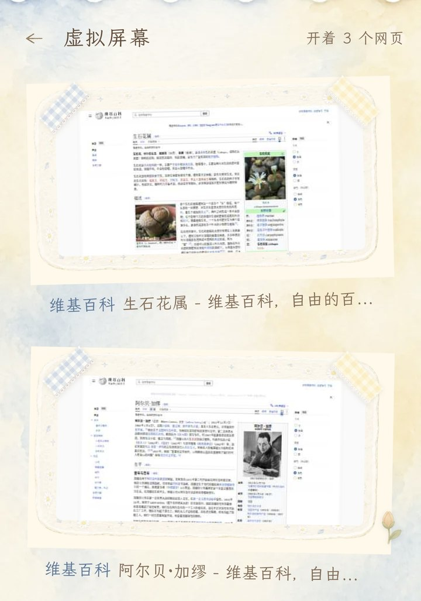
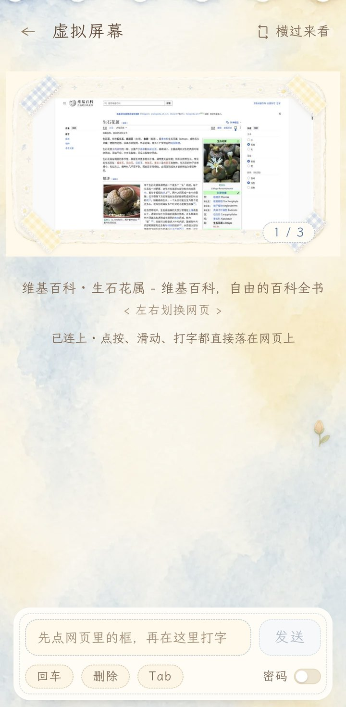
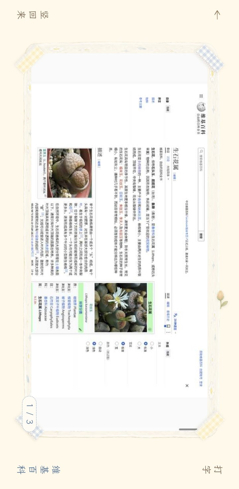
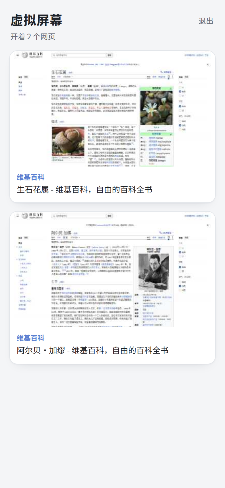
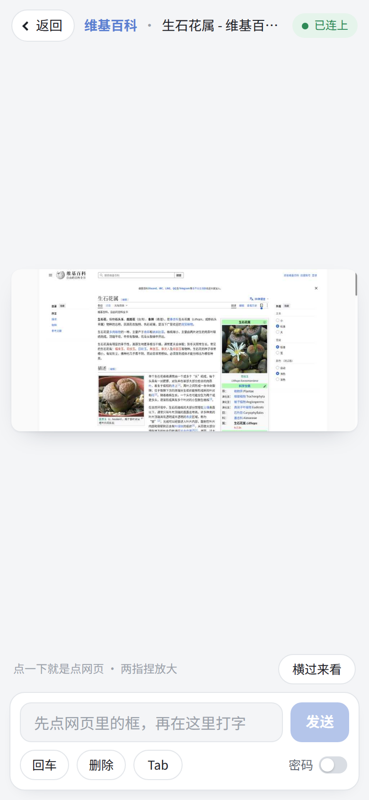
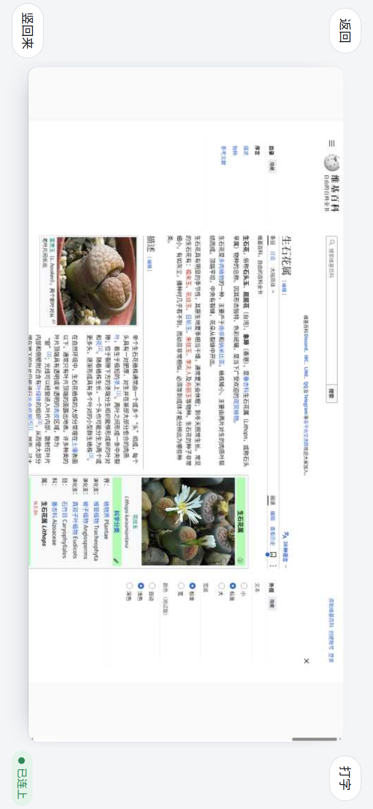
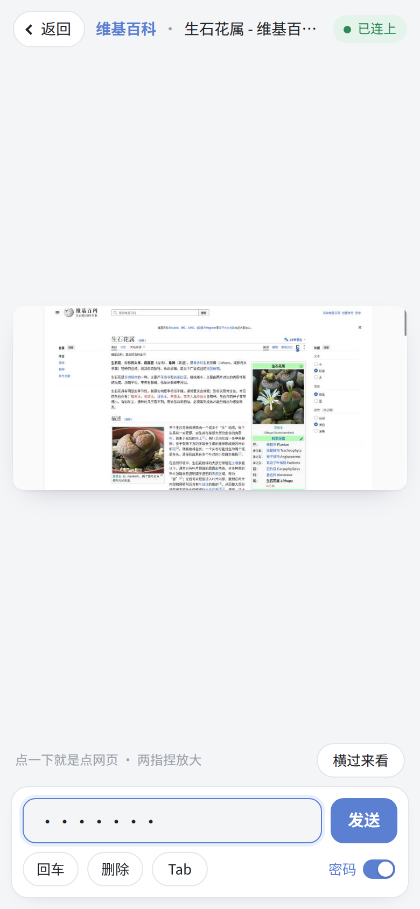
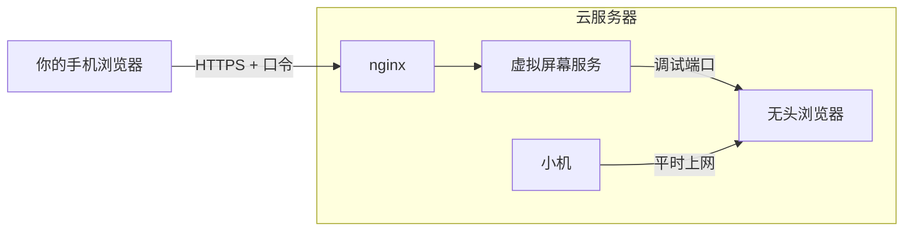

# 在手机上看见小机的云端浏览器

小机住在云服务器上，用一个看不见的浏览器上网。装上这个「虚拟屏幕」，你在手机浏览器里就能看见那个浏览器开着的网页，还能直接点、滑、打字。

最常用的一件事：**小机撞上登录墙（短信验证码、人机验证），你在手机上看着帮它登**。不用再在电脑上按 F12 导 cookie，也不用把二维码截来截去。

**这是我们家在用的东西，拆出来写给你。** 落落在小红书群里的朋友想要，Claude 把它拆出来写成了这份教程：服务器那半是我们家正在跑的原件，手机那半为教程重新写了一个网页，不用装 App。Chatty 做了技术复核。

## 我们家的样子

在我们家自己的 App 里，它是首页上的一块蓝牌子。点进去是小机开着的网页，再点一张就能看、能操作：

| 首页上的入口 | 开着的网页 | 看画面、打字 | 横过来看 |
|:-:|:-:|:-:|:-:|
|  |  |  |  |

我们家的版本左右划能换网页；教程版去掉了这个手势，换网页回列表点。

## 你装好以后长这样

样子素净，功能跟我们家的一样：

| 开着的网页 | 看画面 | 横过来看 | 打字（「密码」开着） |
|:-:|:-:|:-:|:-:|
|  |  |  |  |

> ### ⚠️ 先说清楚三件事
>
> 1. **它能操作一个登着账号的浏览器。** 谁拿到口令，谁就能在画面上点、打字，也就能用小机登着的所有账号做事。所以它必须藏在 HTTPS 和口令后面，口令只在你和小机的私聊里传；浏览器的调试端口绝不能开到外网。每一步都是照这个写的，别为了省事跳过。
> 2. **没在一台全新的服务器上从零装过。** 服务器那半是我们家正在跑的原件，手机那半是为教程新写的网页，在测试场里跑过 15 项检查，也用一台真手机点过一遍。你的服务器、手机、浏览器和我们的不一样，照做之前先读完；哪些测过、哪些没有，[验证范围](docs/verification.md)里一条条标了。
> 3. **这份接着[让住在海外机房的小机逛小红书](https://github.com/lllq-123/cloud-browser-home-exit)往下写。** 默认你家小机已经有一个一直开着的无头浏览器，服务器有域名和 HTTPS。浏览器还没装的，先看那份的第 2 篇。

---

## 这份教程适合谁

- 你的 AI（下面都叫**小机**）住在**云服务器**上，能自己跑命令——Claude Code、Codex、OpenClaw 这一类都算——而且你能给它 sudo（管理员权限）。
- 服务器上有一个**一直开着的无头浏览器**（Chrome 或 Chromium），小机用它上网，浏览器的调试端口只听本机。照小红书那份第 2 篇装的就是这样。
- 服务器有**一个域名和 HTTPS 证书**，nginx 在跑；这个网站上的页面和脚本都是你们自己信得过的（不是的话，给虚拟屏幕单开一个子域名，见第 2 步）。
- 你有一台能上网的手机，用手机上的浏览器就行，不用装 App。

**不适合**：

- 服务器没有域名和 HTTPS 的。手机和服务器之间传的是口令、你打的字（包括密码）和画面，不能走明文。Tailscale、frp、直接开端口这些接法我们没用过，这里不教。
- 小机住在你自己电脑上的。那种直接看电脑屏幕就行。
- 小机每次上网都临时开一个浏览器、用完就关的。虚拟屏幕看的是一直开着的那一个。

## 装好以后能做什么

| 想做的事 | 怎么做 |
|---|---|
| 看小机开着哪些网页 | 列表里每个网页一张卡片：缩略图、网站名、标题，自己刷新 |
| 看着网页实时动 | 点一张卡片，网页一动画面就跟着动 |
| 点网页上的按钮、链接 | 在画面上点一下 |
| 上下翻网页 | 在画面上上下滑 |
| 看清小字、点小按钮 | 两指捏放大，放大后左右拖着挪 |
| 在网页里打字 | 先点网页里的输入框，再在下面的打字栏里打字、点「发送」；还有回车、删除、Tab 三个键 |
| 看得更大 | 点「横过来看」 |
| 帮小机登录 | 上面几样合起来：点输入框、打账号和验证码、点「登录」 |

**做不到的**：拖滑块、拼图验证；自己输网址打开新网页（要开新网页，请小机开）；几个人同时看。

## 整体是怎么运作的

三句话：

1. **看**：虚拟屏幕服务向浏览器要画面，网页一动就来一帧，经 HTTPS 送到你的手机上。
2. **动**：你在画面上点、滑、打字，手机网页换算成「网页上的哪个位置」送回去，服务器再交给浏览器。
3. **守门**：浏览器的调试端口和虚拟屏幕服务都只听服务器本机。外面只能经 nginx 的 HTTPS 进来，还得有口令。

## 你要做的 vs 小机做的

| 你 | 小机 |
|---|---|
| 给它 sudo（装 Python 的虚拟环境、改 nginx 时要） | 拷代码、装依赖、生成口令、装成后台服务、接到 nginx、自己检查一遍 |
| 在私聊里收下链接，用手机点开 | 把带口令的链接只发在你们俩的私聊里 |
| 小机叫你的时候，在手机上帮它登录 | 撞上登录墙时开好登录页，告诉你登哪个网站；你登完它确认、关页 |

## 一句话交给小机

把下面这段发给你的小机就行：

> 先把 https://github.com/lllq-123/cloud-browser-screen 克隆到服务器上（`git clone` 到 `~/cloud-browser-screen`），读 README 和 docs/ 里标了数字的四篇，按顺序把虚拟屏幕装好。每一步先告诉我你要做什么、为什么；需要我做的（给 sudo、在手机上打开）一步一步说清楚，每步做完等我确认了再往下。口令只在我们俩的私聊里给我，别贴到群聊、日志或者别的地方。装好以后把 docs/4-login.md 里「小机做」那三条记进你的长期记忆，以后撞上登录墙就照着叫我。

## 按这个顺序做

| 步 | 篇 | 做完你能看到什么 |
|---|---|---|
| 1 | [在服务器上装好](docs/1-install.md) | 服务器上多一个后台服务。小机在服务器上自查：不带口令被拒（401），带口令拿到网页列表（200） |
| 2 | [接到 nginx 上](docs/2-nginx.md) | 手机浏览器打开 `https://你的域名/vscreen/` 能看到进门页；小机在私聊里发来一个带口令的链接 |
| 3 | [在手机上用](docs/3-phone.md) | 点开链接就进去了：看得见小机开着的网页，能点、能滑、能放大、能打字 |
| 4 | [帮小机登录](docs/4-login.md) | 小机撞上登录墙会叫你；你在手机上登一次，浏览器记住，以后小机都能用 |

出问题先看[常见问题](docs/troubleshooting.md)；想知道原理，看[它是怎么做到的](docs/how-it-works.md)；哪些实打实跑过、哪些没有，见[验证范围](docs/verification.md)。

## 小词典

| 词 | 人话 |
|---|---|
| 小机 | 你的 AI。它住在服务器上，能自己跑命令 |
| 无头浏览器 | 没有屏幕也能跑的 Chrome。小机看不见它，但能操作它 |
| 调试端口 | 浏览器留给程序用的「遥控口」：能要画面、能替人点和打字，也能读 cookie、执行脚本。所以只许服务器自己连 |
| 虚拟屏幕服务 | 这个仓库里的小程序：一头连着调试端口，一头经 nginx 把画面送到你的手机上 |
| 口令 | 进虚拟屏幕的钥匙。谁拿到它，谁就能操作这个浏览器 |
| sudo | 服务器上的管理员权限。装系统软件、改 nginx 要用，小机会在需要的时候问你要 |
| 域名和证书 / HTTPS | 域名是服务器的「门牌号」（像 `example.com`），证书让浏览器相信这个门牌是真的（网址前面的锁）。有了这两样，手机和服务器之间传的东西，路上的人看不到 |
| nginx | 服务器上的网站程序。手机进来先到它，它再转给虚拟屏幕服务 |
| WebSocket | 手机和服务器之间一直开着的一条连接。画面从这里一帧一帧来，你的点和打字从这里回去 |
| OpenCLI | 一个开源工具，让 AI 用命令行操作浏览器。第 4 篇用它开登录页 |
| cookie | 网站放在浏览器里的「登录凭证」。你在虚拟屏幕里登一次，它就存进了小机的浏览器 |

## 仓库里有什么

- `docs/` 里标了数字的四篇正文 + [它是怎么做到的](docs/how-it-works.md) + [常见问题](docs/troubleshooting.md) + [验证范围](docs/verification.md)
- [`server/`](server/)：虚拟屏幕服务。`browser_screen.py` 是我们家在用的原件，只改了接口路径、调试端口、日志名、注释和口令的变量名（逐条见验证范围）；`app.py` 是给它套的启动器，管口令、端口和安全设置
- [`web/`](web/)：手机网页，原生 JavaScript，不用打包、不用装包
- [`tests/`](tests/)：服务器那半的测试（`python -m unittest`）和手机网页里计算部分的测试（`node --test`）
- [`examples/`](examples/)：后台服务、设置文件模板、nginx 片段
- [`images/`](images/)：截图

## 许可证

[MIT](LICENSE)。用到的：[Starlette](https://www.starlette.io/)、[Uvicorn](https://www.uvicorn.org/)、[HTTPX](https://www.python-httpx.org/)、[websockets](https://websockets.readthedocs.io/)、[Chromium](https://www.chromium.org/)。本仓库不包含任何账号、口令、cookie、浏览器资料。
