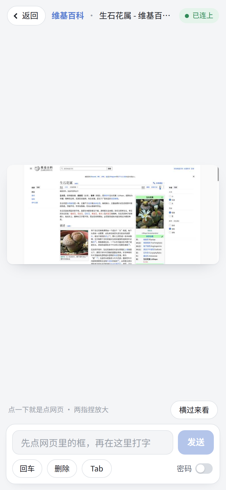
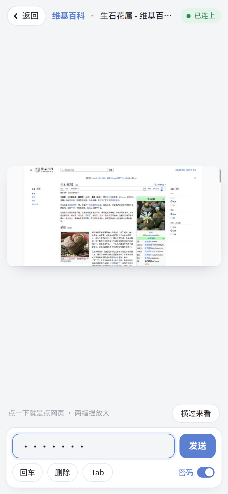
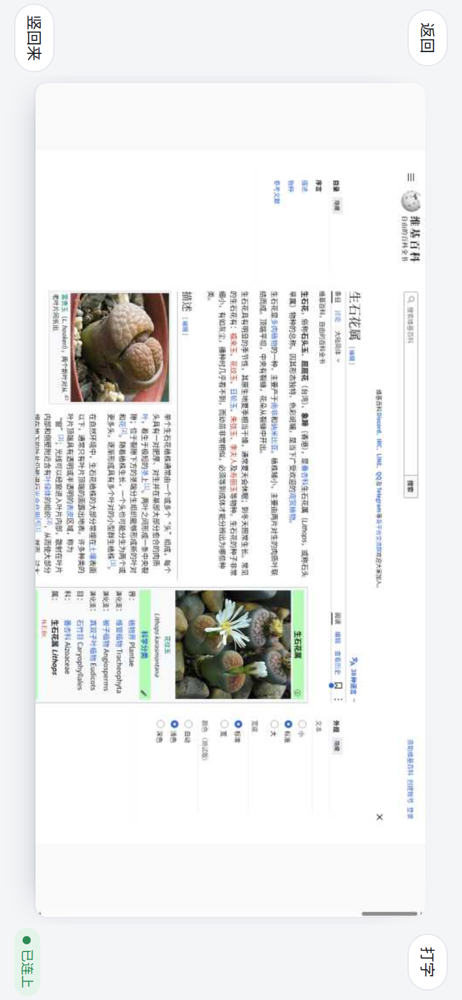

# 第 3 步：在手机上用

> 这一步做完：你知道每个按钮管什么，看到提示知道是怎么回事。

这一篇是写给你（主人）的，小机这一步不用做什么。用手机自带的浏览器就行，不用装 App。

## 1. 进门

点小机在私聊里发来的链接，直接就进去了。

没有链接的话，在手机浏览器里打开 `https://你的域名/vscreen/`，把口令粘贴进框里，点「进去」。

- 口令会存在**这台手机的这个浏览器**里，以后再打开不用再输。换了浏览器、清了浏览器的数据，要再输一次。
- 列表右上角的「退出」：把这台手机上存的口令删掉，回到进门页。手机要借给别人、或者小机换了口令，点一下。它只管你点的这个标签页：同一个浏览器里别的标签页要是也进过虚拟屏幕，一起关掉。担心口令被别人拿到了，光「退出」不够，要请小机换口令。
- 进门页提示「口令不对」：口令输错了，或者小机换过口令。问小机要新的。
- 提示「连不上服务器」：手机没网，或者服务器上的服务没在跑，见[常见问题](troubleshooting.md)。

## 2. 网页列表

- 标题下面写着「开着 N 个网页」。每张卡片是小机开着的一个网页：上面是缩略图，下面是网站名和标题。新开的排在最前面。
- 不用手动刷新：列表 2 秒更新一次，缩略图 6 秒一次。小机开了新网页会自己冒出来，关了会自己消失。
- 一个都没开的时候显示「现在没有开着的网页」。想看的网页不在列表里，就请小机先把它打开。
- 点一张卡片，进去看这个网页。

## 3. 看画面

顶上一行是「返回」、网站名和标题、连接状态。状态有五种：连接中、已连上、重连中、已暂停、已断开。

在画面上：

| 手势 | 效果 |
|---|---|
| 点一下 | 在网页上点一下，跟鼠标点一下一样 |
| 上下滑 | 滚动网页，跟着手指走 |
| 两指捏 | 放大，最多 4 倍。放大到 1.2 倍以上，画面会换成更清楚的 |
| 放大以后左右拖 | 左右挪画面，看两边（上下滑还是滚网页） |
| 点画面左上角的「2.0×」这种小按钮 | 恢复原大小 |

- **换网页**：点「返回」回列表，再点另一张。左右划不会换网页。
- 手机的返回键、返回手势，也是回列表。
- 切到别的 App、锁屏：画面自动暂停，显示「画面已暂停，回到这里会自动接上」。

**看完记得点「返回」。**你停在某个网页上的时候，虚拟屏幕会一直把它留在浏览器的最前面，不然画面会停住。这期间小机在别的网页上点击、打字会变慢（我们家量过：从 1 秒左右变成 6 秒左右，照样能成）。回到列表、切到后台、关掉页面，都会马上还回去。

## 4. 打字

1. 先在画面上**点一下网页里的输入框**，让光标进去。
2. 在下面的打字栏里打字，点「发送」（或者输入法上的发送键）。打的字一下子送进网页，中文英文都行，一次最多 2000 个字。
3. 下面三个键，各按一下：
   - 「回车」：很多搜索框、登录框，打完按它就提交了
   - 「删除」：删掉网页里光标前面的一个字
   - 「Tab」：跳到下一个输入框

**「密码」开关**：打密码之前打开它。它只管你手机这一头：打字栏里的字显示成圆点，旁边的人看不到；它还会告诉手机「这是密码」，输入法记不记、联不联想，就看各家手机和输入法了。网页那边收到的字和不开的时候一模一样，网页里的密码框本来就显示圆点，所以开不开，画面上看不出区别——这是正常的，不是没生效。

服务器的日志里只记「打了几个字」，你打的内容一个字都不记。

## 5. 横过来看

点「横过来看」，画面会转过来。把手机向左横过来拿（原来的右边朝上），网页能看得更大。

- 横着的时候，左边是「返回」「竖回来」，右边是「打字」和连接状态。
- 横着也能点、滑、放大，用法跟竖着一样。
- 要打字就点「打字」：会先竖回来再弹出键盘（转过来的画面里，键盘会是歪的）。
- 点「竖回来」，回到竖着看。
- 手机开着「自动旋转」的，也可以直接把手机横过来。这时没有「竖回来」，把手机竖回来就行；点「打字」会在横着的画面里打开打字栏。

## 6. 各种提示是什么意思

**画面上盖着的字**

| 看到 | 什么意思 | 要不要管 |
|---|---|---|
| 正在连接… | 正在接上这个网页，等第一帧画面 | 等一两秒 |
| 画面已暂停，回到这里会自动接上 | 你切到别的 App 或者锁屏了，虚拟屏幕先把网页还给了小机 | 不用管，回来自己接上 |
| 这个网页关掉了 | 小机把这个网页关了 | 不用管，一会儿自己回列表 |
| 连接断开了，马上重连（1/2）… | 网络晃了一下 | 不用管，会自己重连 |
| 太久没动静，连接断了 | 30 秒没收到对面的消息，多半是网不好 | 同上 |
| 服务器上的浏览器暂时连不上 | 小机的浏览器关了，或者正在重启 | 同上；一直这样就告诉小机 |
| 在别的地方打开了，这里先停下 | 你在另一台手机、或者另一个浏览器标签页里打开了虚拟屏幕。一次只能有一个地方看，新开的那边把这边顶掉了 | 这边不会自动抢回来，不然两边会来回抢个没完。想在这边看，点「回列表」再点进去，那边就会停下 |
| 口令不对了，回列表重新进 | 小机换过口令了 | 点「回列表」，会回到进门页，用新口令进 |

自动重连最多两次。两次都没连上，画面上会出现「重新连接」按钮，点它再试。

**画面下面一闪而过的小字**：连接还在，只是刚才那一下没成功。

| 看到 | 什么意思 |
|---|---|
| 刚才那下没送到网页上 | 那一下点击或者打字没送进去，再来一次 |
| 画面还没接上，刚才那下没送出去 | 画面还没出来你就点了，等画面出来再点 |
| 那个网页已经关掉了 | 小机刚把这个网页关了 |
| 刚才那下没成功 | 别的原因，再来一次 |

**列表上的提示**

| 看到 | 什么意思 |
|---|---|
| 正在看看开着哪些网页… | 刚进来，正在取列表 |
| 服务器上的浏览器暂时连不上，正在重试… | 虚拟屏幕服务好着，小机的浏览器没开或者在重启 |
| 连不上服务器，正在重试… | 手机没网，或者服务器上的虚拟屏幕服务没在跑 |
| 列表这会儿没刷新上，正在重试… | 偶尔一次没取到，一般下一次就好 |
| 那个网页暂时连不上 | 你刚才点的那张网页出了问题，先回到了列表 |

还是不对的，看[常见问题](troubleshooting.md)。

## 7. 流量

一直在动的网页（比如在滚动），我们家量的是每秒 500 多 KB，一分钟 30 MB 上下；不动的网页大约 2 秒才来一帧，几乎不费流量。帮小机登录的时候网页大多是不动的。用手机流量看的话，看完就点「返回」。

---

下一步：[小机撞上登录墙，请你在手机上帮它登](4-login.md)。
