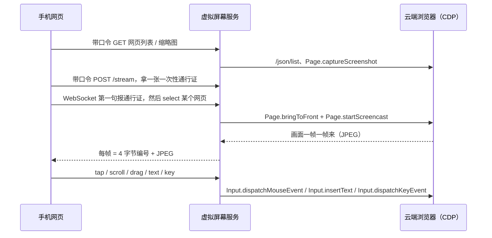

# 它是怎么做到的

给好奇的你，也给要改它的小机。不看这篇也能装、能用。

## 一句话

浏览器自己有一个「调试端口」（Chrome DevTools Protocol，下面简称 CDP），能让程序要到网页的画面、替人点击和打字。虚拟屏幕服务在服务器上连着这个端口，把画面转给你的手机，再把你的点、滑、打字转回去。手机和服务器之间只走 HTTPS，服务器和浏览器之间只在本机里。

## 几样东西各管什么

| 手机上看到的 | 服务器上靠的是 |
|---|---|
| 网页列表 | 调试端口的 `/json/list`，只留真网页（去掉空白页、`chrome://`、插件页），新开的排最前，顺序不乱跳 |
| 缩略图 | `Page.captureScreenshot`，只截屏幕上那一块，缩成 480 宽，每张缓存 5 秒，一张一张截 |
| 实时画面 | `Page.startScreencast`：网页一变，浏览器就推一帧 JPEG。平时 960 宽、质量 50；你放大到 1.2 倍以上，换成 1920 宽、质量 60 |
| 点一下 | 一组鼠标事件：移过去、按下、松开 |
| 原大小时上下划 | 鼠标滚轮 |
| 放大后单指划 | 手机在画框内平移已收到的画面，两个方向都可以移动 |
| 按住约半秒后拖动 | 手机把手指的位置和当前画面的编号发给服务器，服务器让浏览器按下鼠标左键、随手移动、松开 |
| 打字 | `Input.insertText`，中文英文都行，不经过手机键盘的「按键」 |
| 回车、删除、Tab | 对应的键盘事件。服务器只认这三个加 Esc（手机网页上没放 Esc 的按钮） |

## 那些看起来多余的规矩，都是踩过的坑

**1. 一次只有一条看屏连接，新的顶掉旧的。** 浏览器同一时间只能把一个网页摆在最前面，两个人各看各的会互相抢。你在另一台设备上打开，这边会提示「在别的地方打开了」，并且不会自动抢回来，不然两边会来回抢个没完。

**2. 每一帧前面带一个编号。** 你从网页 A 换到网页 B 的那一刻，A 的最后几帧可能还在路上。编号对不上的帧直接丢掉，不然画面会闪回 A。

**3. 每秒最多 15 帧，多出来的在服务器丢掉。** 浏览器允许同时有两帧在路上，就算晚回确认也压不住它的速度（我们家实测还是每秒 20 帧左右），所以只能在服务器这边丢。按每秒 15 帧、960 宽算，一直在动的网页每秒大约 0.6 MB；不动的网页大约 2 秒才来 1 帧，几乎不费流量。

**4. 你看哪个网页，就把它拉到最前面；你离开时，把原来在前面的还回去。** 小机所有的网页都在同一个浏览器窗口里，只有最前面那个会好好渲染：我们家实测，后台网页 3 秒钟 0 帧，在后台网页上点击、打字要 6 秒左右（前台 1 秒左右）。所以：

- 你看着某个网页时，服务器每 2 秒查一次。它被小机新开的网页顶到后面了，就把它拉回来（我们家量过一次，画面停了 0.48 秒；照设计最坏大约 2 秒）
- 你回到列表、关掉页面、断线，服务器就把窗口还给原来在前面的那个网页
- 手机网页回到列表就断开连接，不然服务器会一直替你把最后看的那个网页留在前面

**5. 跳到别的网站，画面会停，要重新开。** 网页跳到另一个网站以后，浏览器会悄悄停掉连续画面。服务器听到「主框架换了」就重开一次，画面接着来。

**6. 只收白名单里的操作。** 调试端口什么都能做：读 cookie、执行任意脚本、打开任何网址。手机网页能发的只有：选网页、点、滚动、拖动、打字（最多 2000 字）、回车 / 删除 / Tab / Esc、要不要高清、心跳。别的一律当成坏消息，整条连接直接断开。网页编号也只认列表里现有的，所以没法用它打开新网址，也没法转发任意 CDP 命令。

**7. 打的字不进日志。** 日志里只记「打了 10 个字」这种长度，和每种操作做了几次。

**8. 坐标由服务器换算。** 手机发的是「帧图上的第几个像素」加上帧图的宽高，全部是整数；服务器按浏览器窗口的真实大小换算。手机横过来看、放大了的时候，手机网页先把旋转和放大换算回帧图上的像素再发。

**9. 带口令的图片不能直接用 ``。** 浏览器加载 `` 时不会带上口令，会被拒（401）。手机网页是带着口令把图片取回来，再交给 `` 显示的。

## 安全上的几道门

| 门 | 挡住什么 |
|---|---|
| 浏览器调试端口只听本机 | 外面的人直接控制浏览器 |
| 虚拟屏幕服务只听本机，外面只能经 nginx 的 HTTPS 进 | 口令、画面、你打的字在路上被看到 |
| 口令（至少 32 个字符，比较时不泄露时间差） | 没口令的人看画面、拿列表 |
| WebSocket 的一次性通行证（30 秒内不用就作废） | 口令出现在 WebSocket 地址里、被记进日志 |
| 只收白名单操作、只认列表里的网页编号 | 拿到口令的人借它执行任意脚本、读 cookie、开任意网址 |
| 手机网页把网页标题、网址一律当纯文字显示，外加内容安全策略（CSP） | 有人把一段脚本写进网页标题，借你的手机网页偷口令 |

口令拿到手的人，还是能在画面上点、打字，也就能用小机登着的账号做事。所以最后一道门是你自己：口令只在私聊里传。

## 我们家实测的数字（2026 年 10 月）

浏览器窗口 1920×1040（网页区域 1920×897），2 核服务器：

| 量了什么 | 结果 |
|---|---|
| 打开一个网页到第一帧 | 80 毫秒左右（960×452，41 KB） |
| 一直在滚动的网页 | 每秒 14～15 帧，525 KB/s 左右 |
| 不动的网页 | 2 秒 1 帧 |
| 截一张前台网页 | 40 毫秒左右；后台网页缩小到四分之一截，76 毫秒 |
| 看着画面的时候小机跑 OpenCLI 命令 | 命令照常（每条 0.7～1.1 秒），画面不断 |
| 小机新开网页把你看的那个顶到后面 | 量了一次：画面停 0.48 秒就被拉回来 |
| 服务器日志里有没有打过的字 | 没有：只有 `vscreen text chars=10` 这种 |
